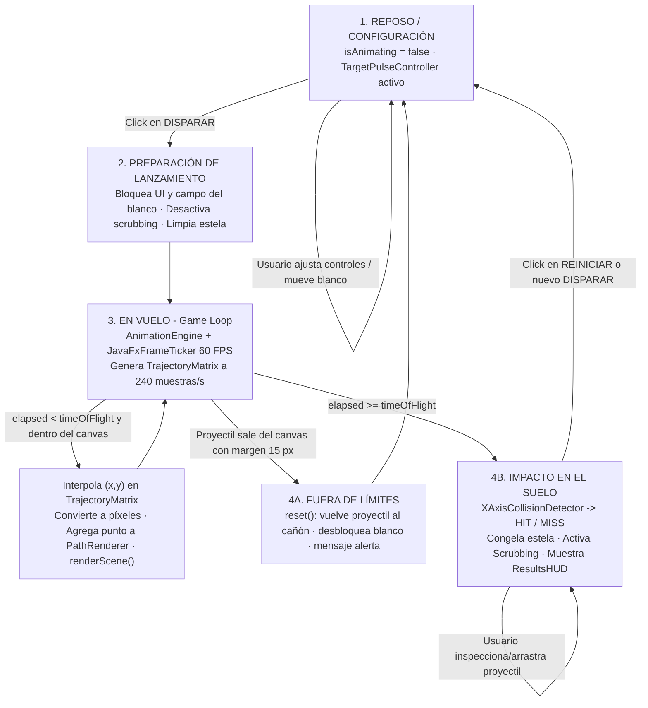

# Guía de Estudio y Defensa — Simulación de Cañón (Tiro Parabólico)

> **Proyecto:** Simulación interactiva de tiro parabólico en 2D ("Simulación de Cañón")  
> **Autores:** Matteo Catania y Agustín Marañón  
> **Stack técnico:** Kotlin (JVM 21), JavaFX 21 (`javafx-controls`, `javafx-graphics`), Gradle 9.4.1, JUnit 5 / `kotlin-test`  
> **Clase principal ejecutable:** `org.example.CannonSimulation` (`./gradlew run`)  
> **Suite de pruebas:** `./gradlew test` (96 tests unitarios y de integración)

---

## 1. Arquitectura y flujo general del juego

### ¿De qué trata el juego?
Es un simulador interactivo de física clásica (tiro parabólico en 2D sin resistencia del aire) con interfaz gráfica en JavaFX. El jugador configura los parámetros del lanzamiento (**Ángulo**, **Velocidad Inicial**, **Gravedad** y **Masa**), ubica un **blanco (diana)** sobre el suelo (arrastrándolo con el mouse, escribiendo la distancia en metros o usando el botón **OBJETIVO ALEATORIO**) y presiona **DISPARAR**.

Al terminar el vuelo por impacto contra el suelo, el simulador informa si hubo **IMPACTO (`HIT`)** o **FALLO (`MISS`)**, muestra una tarjeta con los **RESULTADOS DEL VUELO** y habilita el modo **Scrubbing**: la estela queda congelada y el usuario puede pasar el mouse o arrastrar el proyectil a lo largo de la parábola recorrida para inspeccionar en tiempo real su velocidad y altura instantáneas en cada punto.

---

### Flujo de arranque (Bootstrap e Inyección de Dependencias)

```text
CannonSimulation.main()
  └─ Application.launch(CannonSimulation::class.java)
       └─ JavaFX instancia CannonSimulation()  [@JvmOverloads]
            └─ start(primaryStage)
                 └─ DefaultSimulationBootstrapper.launchStage(primaryStage)
                      ├─ 1. DefaultSimulationAppAssembler.defaultConfig() -> SceneConfig (900 x 550)
                      ├─ 2. Crea Canvas(900, 550)
                      ├─ 3. DefaultSimulationWorkspaceFactory.create(canvas, cfg)
                      │     ├─ DefaultWorkspaceCoreBuilder -> SimulationState, DefaultCoordinateTransformer (2.5 px/m), PathRenderer
                      │     └─ WorkspaceVisualsWiring -> TargetRenderer + JavaFxTargetOverlayPill + TargetDistanceController
                      │                                + SceneRenderer + ScrubbingController
                      ├─ 4. SimControlsWiring.buildInteractiveControls(workspace)
                      │     ├─ FlightEngineWiring -> AnimationEngine (timeScale=1.85, 240 muestras/s) + FlightEventHooks
                      │     └─ ControlPanelWiring -> ControlPanel (sliders + campos editables + botones + banner)
                      ├─ 5. SimulationStageBuilder.mount(stage, controlsBox, canvasLayer, cfg) -> arma Scene y muestra ventana
                      ├─ 6. workspace.installOn(canvas) -> instala mouse handlers de Scrubbing y TargetDrag + inicia pulso
                      └─ 7. workspace.renderScene() -> primer fotograma
```

---

### Bucle principal (Game Loop) y flujo de estados

El proyecto no usa una clase explícita de máquina de estados (`enum State`), sino que el ciclo de vida del juego se coordina mediante banderas encapsuladas (`SimulationState.checkAnimating()`, `ScrubbingController.checkEnabled()` y `JavaFxTargetOverlayPill.isLocked()`) y **dos `AnimationTimer` de JavaFX**:



**Detalle paso a paso del Game Loop (`AnimationEngine.kt`):**
1. **En reposo:** `TargetPulseController` corre un `AnimationTimer` que solicita repintado mientras `!state.checkAnimating()` para animar el pulso sinusoidal de la diana (`±6%` de radio).
2. **Al disparar (`AnimationEngine.start()`):**
   - `SamplingTrajectoryMatrixGenerator.generate(params, 240)` precalcula toda la trayectoria física a **240 puntos por segundo** y la guarda en un `TrajectoryMatrix` inmutable.
   - `JavaFxFrameTicker` arranca un `AnimationTimer`.
3. **En cada frame (`AnimationEngine.tick(now)`):**
   - Calcula `elapsed = ((now - flightStartTimeNano) / 1e9) * timeScale` (en la app `timeScale = 1.85` para una sensación visual ágil).
   - Si `elapsed < totalTimeOfFlight()`: interpola `(x, y)` entre los dos puntos vecinos de `TrajectoryMatrix` mediante búsqueda binaria (`TrajectoryMatrix.interpolateAt()`), lo pasa a coordenadas de pantalla con `DefaultCoordinateTransformer`, comprueba `isOutOfBounds()` (margen de `15 px`), actualiza `SimulationState`, registra el punto en `PathRenderer` y llama `SceneRenderer.render()`.
   - Si `elapsed >= totalTimeOfFlight()`: ejecuta `handleGroundImpact()`, posiciona el proyectil exactamente en el punto final, evalúa la colisión con `XAxisCollisionDetector`, notifica a `ControlPanel` (`showCollisionResult`), congela la estela (`pathRenderer.freeze()`), habilita `ScrubbingController` con `PhysicsTrajectoryInspectorAdapter`, detiene el ticker y repinta la escena.

---

### Conexión entre módulos

| Módulo (paquete) | Depende de (contratos) | Qué provee al resto |
|---|---|---|
| `org.example` (raíz) | Todos los módulos | Punto de entrada (`CannonSimulation`), física pura (`Physics.kt`), composición/wiring y fábricas generales |
| `org.example.model` | `org.example`, `collision`, `telemetry` | Estado mutable central (`SimulationState`), contenedor de trayectoria (`TrajectoryMatrix`) y modelo `Target` |
| `org.example.trajectory` | `org.example`, `model` | Muestreo temporal (`SamplingTrajectoryMatrixGenerator`), interpolación al suelo e índice por búsqueda binaria |
| `org.example.collision` | `org.example`, `model`, `trajectory` | Evaluación geométrica `HIT` / `MISS` / `UNKNOWN` en el eje X (`XAxisCollisionDetector`) |
| `org.example.animation` | `model`, `collision`, `rendering`, `trajectory` | Motor de vuelo frame-a-frame (`AnimationEngine`), ticker JavaFX/Manual y ganchos de eventos (`FlightEventHooks`) |
| `org.example.rendering` | `model`, `scrubbing` | Configuración geométrica (`SceneConfig`), conversión metros↔píxeles y pintores 2D sobre `Canvas` |
| `org.example.telemetry` | `org.example`, `model` | Consulta del estado instantáneo más cercano a un `(x, y)` o `x` (Nearest Neighbor 2D / búsqueda binaria 1D) |
| `org.example.scrubbing` | `model`, `rendering`, `telemetry` | Inspección post-vuelo interactiva, `ResultsHUD`, `TooltipRenderer` y halos interactivos |
| `org.example.ui` | `model`, `collision`, `rendering` | Panel lateral `ControlPanel`, validación numérica, sincronización slider↔texto y pastilla editable bajo el blanco |

---

## 2. Resumen de archivos y su función

> **Nota arquitectónica sobre archivos `*Contract.kt` / `*Contracts.kt`:** Para cumplir con los principios SOLID (en especial **ISP** — segregación de interfaces — y **DIP** — inversión de dependencias), casi cada módulo separa sus **interfaces** en archivos `*Contract(s).kt` pequeños y sus **implementaciones concretas** en archivos separados.

### A. Configuración del proyecto y Gradle

| Archivo | Responsabilidad principal | Elementos clave | Comunicación / Notas |
|---|---|---|---|
| `settings.gradle.kts` | Define el proyecto raíz y submódulo | `rootProject.name = "Proyecto"`, `include("app")`, plugin `foojay-resolver-convention` | Orquesta el proyecto multi-módulo Gradle |
| `app/build.gradle.kts` | Configura Kotlin JVM 21, JavaFX 21, dependencias y ejecución | `mainClass = "org.example.CannonSimulation"`, tarea `run` con `--module-path` y `--add-modules`, `useJUnitPlatform()` | Conecta JUnit 5 y JavaFX 21 (`-linux` classifier) |
| `gradle/libs.versions.toml` | Catálogo central de versiones | `kotlin`, `junit-jupiter-engine`, `guava`, `kotlinx-serialization-json` | Referenciado por `app/build.gradle.kts` |

---

### B. Punto de entrada, ensamblaje y física base (`app/src/main/kotlin/org/example/`)

| Archivo | Responsabilidad principal | Clases / Funciones / Datos clave | Cómo se comunica con el resto |
|---|---|---|---|
| `CannonSimulation.kt` | **Punto de entrada JavaFX** y raíz de composición (Composition Root) de toda la app | `CannonSimulation` (`@JvmOverloads constructor`, `start`, `main`), `DefaultSimulationBootstrapper`, `DefaultSimulationAppAssembler`, `SimulationStageBuilder`, `SimulationWorkspace`, `WorkspaceCore`, `WorkspaceVisuals`, `TargetInteractionCoordinator`, `SimControlsWiring`, objetos `*Wiring` | Ensambla e inyecta todos los módulos: `SimulationState`, `SceneRenderer`, `TargetRenderer`, `ScrubbingController`, `AnimationEngine`, `ControlPanel` y `TargetDistanceController` |
| `SimulationAssemblerContracts.kt` | Contratos de ensamblaje y arranque | `ISimulationBootstrapper`, `ISimulationAppAssembler`, `ISimulationStageBuilder`, `ISimulationWorkspaceFactory`, `IFlightEngineWiring`, `ISimControlsWiring`, etc. | Desacopla `CannonSimulation` de los constructores concretos |
| `SimulationWorkspaceContract.kt` | Contratos del espacio de trabajo visual | `IWorkspaceCore`, `IWorkspaceVisuals`, `ISimulationWorkspace` (`renderScene`, `prepareForLaunch`, `resetInteractionAndTrail`, `onFlightFinishedWithImpact`) | Interfaz principal que usan `FlightHooksWiring`, `FlightEngineWiring` y `SimControlsWiring` |
| `Physics.kt` | **Motor matemático de física parabólica** y modelos de valor inmutables | `PhysicsParams` (valida ángulo `[-90,90]`, `v >= 0`, `g > 0`, `m > 0`), `TrajectoryPoint` (`x, y, vx, vy, t`, `speed()`), `ParabolicTrajectoryCalculator` (`calculateState`, `calculateTimeOfFlight`, `calculateRange`, `calculateMaxHeight`), `TrajectoryCalculatorFactory`; además `TrajectoryFrame`, `TrajectoryData`, `SimulationRunner` | Es consumido por `SamplingTrajectoryMatrixGenerator` para generar cada punto de la parábola y por `SimulationState` al empaquetar parámetros |
| `PhysicsContracts.kt`, `PhysicsParamsContract.kt`, `TrajectoryPointContract.kt`, `PhysicsRunnerContracts.kt` | Interfaces del dominio físico | `TrajectoryCalculator`, `ITrajectoryCalculatorFactory`, `IPhysicsParams`, `ITrajectoryPoint`, `ITrajectoryData`, `ISimulationRunner` | Permiten intercambiar el modelo físico (OCP/DIP) sin modificar generación ni UI |
| `Position.kt` y `DomainContracts.kt` | Coordenada 2D física inmutable | `Position(x, y)` e interfaz `IPosition` (`horizontal`, `vertical`, `distanceTo`, `translate`) | Usado por `InstantaneousState` y sobrecargas de consulta de telemetría |
| `TrajectorySimulationFactory.kt` y `SimulationFactoryContracts.kt` | Fábrica abstracta del subsistema de física, generación, búsqueda y colisiones | `DefaultKinematicsBuilder`, `DefaultSearcherBuilder`, `DefaultCollisionBuilder`, `DefaultTrajectorySimulationFactory`, `SimulationFactoryWiring`, `TrajectorySimulationFactory` | Provee `TrajectoryMatrixGenerator` y `CollisionDetector` a `AnimationEngine.kt`, `App.kt` y tests |
| `App.kt` | Demostración independiente por consola (CLI) | `App.executeDemo()`, `App.main()` | *(Nota de estudio)* No es el `mainClass` de Gradle; ejecuta una simulación fija (`45°`, `25 m/s`) e imprime matriz, colisión y telemetría por stdout |

---

### C. Subpaquete auxiliar de física (`app/src/main/kotlin/org/example/physics/`)

| Archivo | Responsabilidad principal | Clases / Funciones clave | Comunicación / Notas |
|---|---|---|---|
| `PhysicsEngine.kt` | Interfaz simple de motor físico por tiempo | `interface PhysicsEngine { fun getState(time: Double): Position }` | *(Nota de estudio — sin uso activo)* No es implementada ni consumida por `CannonSimulation` ni por `AnimationEngine` |
| `MockPhysicsEngine.kt` | Motor lineal de prueba (`x = 20t, y = 10t`) | `class MockPhysicsEngine : PhysicsEngine` | *(Nota de estudio — sin uso activo)* Prototipo inicial para pruebas de animación sin física parabólica |

---

### D. Modelo y estado (`app/src/main/kotlin/org/example/model/`)

| Archivo | Responsabilidad principal | Clases / Funciones / Valores clave | Cómo se comunica con el resto |
|---|---|---|---|
| `SimulationState.kt` | **Fuente única de verdad (Single Source of Truth)** del estado mutable del juego | `LaunchParametersState` (defaults: `45°`, `50 m/s`, `9.8 m/s²`, `10 kg`), `TargetAndCollisionState` (default `targetX = 750 px`, `targetRadius = 20 px`), `SimulationState` (delega ambos + posición del proyectil y `isAnimating`) | Leído y actualizado por `ControlPanel`, `AnimationEngine`, `TargetRenderer`, `TargetDistanceController`, `SceneRenderer` y `ScrubbingController` |
| `SimulationStateContract.kt`, `LaunchKinematicsContract.kt`, `EnvironmentParametersContract.kt`, `FlightMotionContract.kt`, `TargetStateContract.kt` | Interfaces segregadas (ISP) del estado | `ISimulationState`, `ILaunchParametersState`, `ILaunchKinematics`, `IEnvironmentParameters`, `IFlightMotionState`, `ITargetAndCollisionState` | Evitan que cada consumidor dependa de propiedades que no usa |
| `TrajectoryMatrix.kt` y `TrajectoryMatrixContract.kt` | Contenedor inmutable de la trayectoria muestreada | `TrajectoryMatrix` (`trajectoryPoints`, `totalTimeOfFlight`, `horizontalRange`, `peakHeight`, `interpolateAt(elapsed)` con búsqueda binaria `O(log n)`, `getInstantaneousState`) e interfaz `ITrajectoryMatrixSummary` | Generado por `SamplingTrajectoryMatrixGenerator`, reproducido por `AnimationEngine`, evaluado por `XAxisCollisionDetector` e inspeccionado por `Scrubbing` y `Telemetry` |
| `Target.kt` | Modelo físico 1D de la diana sobre el eje X | `Target(centerX, radius)` (`left`, `right`, `diameter`, `contains`, `distanceToCenter`, `isHit`) | Instanciado por `FlightCollisionEvaluator` al traducir la diana de píxeles a metros para `XAxisCollisionDetector` |

---

### E. Generación, búsqueda e interpolación de trayectoria (`app/src/main/kotlin/org/example/trajectory/`)

| Archivo | Responsabilidad principal | Clases / Funciones clave | Cómo se comunica con el resto |
|---|---|---|---|
| `TrajectoryMatrixGenerator.kt` y `TrajectoryGeneratorContracts.kt` | Discretiza la ecuación parabólica en una matriz de puntos | `SamplingTrajectoryMatrixGenerator` (`generate(params, samplesPerSecond)`, garantiza incluir el punto exacto en `t = timeOfFlight`; `DEFAULT_SAMPLES_PER_SECOND = 120`, aunque `AnimationEngine` usa `240`) | Invocado por `FlightKinematicsPort.generateMatrix()` al iniciar cada disparo |
| `TrajectoryInterpolator.kt` | Refina el cruce exacto con el suelo (`y = 0`) | `LinearTrajectoryInterpolator` (`interpolateToGround`, `calculateGroundCrossing`) | Inyectado en `XAxisCollisionDetector` para calcular el punto exacto de impacto cuando la muestra cruza de `y > 0` a `y <= 0` |
| `TrajectorySearcher.kt` y `TrajectorySearcherContract.kt` | Búsqueda binaria `O(log n)` por coordenada X | `BinaryTrajectorySearcher` (`findClosestIndexByX`, `findClosestByX`) | Expuesto por `TrajectorySimulationFactory` y probado en `TrajectoryMatrixTest` (en scrubbing se usa `EuclideanNearestNeighborSearcher`) |

---

### F. Detección de colisiones (`app/src/main/kotlin/org/example/collision/`)

| Archivo | Responsabilidad principal | Clases / Funciones clave | Cómo se comunica con el resto |
|---|---|---|---|
| `CollisionDetector.kt` | Lógica de impacto en eje X y modelos de resultado polimórficos | `enum CollisionStatus` (`HIT` verde `#4ade80`, `MISS` rojo `#f87171`, `UNKNOWN` naranja `#fb923c`, con `formatBanner()` y `colorHex()`), `ImpactResult`, `CollisionResult`, `DefaultCollisionResultFactory`, `XAxisCollisionDetector` (`checkCollision`, `isInsideTarget`, tolerancia por defecto `0.5 m`) | Invocado por `FlightCollisionEvaluator` al aterrizar; el `ICollisionResult` se guarda en `SimulationState` (cambia color de la diana) y se envía a `StatusBannerPresenter` |
| `CollisionDetectorContract.kt`, `CollisionResultContract.kt`, `CollisionTargetContract.kt`, `ImpactResultContract.kt` | Contratos del subsistema de colisiones | `CollisionDetector`, `ICollisionResultFactory`, `ICollisionResult`, `ICollisionTarget`, `IImpactResult` | Desacoplan motor de animación y UI de `XAxisCollisionDetector` |

---

### G. Motor de animación y game loop (`app/src/main/kotlin/org/example/animation/`)

| Archivo | Responsabilidad principal | Clases / Funciones clave | Cómo se comunica con el resto |
|---|---|---|---|
| `AnimationEngine.kt` | **Motor de vuelo y bucle principal** | `AnimationEngine` (`start`, `stop`, `reset`, `tick`, `processInFlight`, `handleGroundImpact`, `isOutOfBounds`, `interpolatePosition`), `FlightKinematicsPort`, `FlightCollisionEvaluator`, `FlightEventHooks`, `DefaultAnimationRuntimeContext`, fábricas `*Wiring` | Orquesta física, colisiones y callbacks hacia `SimulationWorkspace` y `ControlPanel` |
| `AnimationListeners.kt` | Adaptadores de reloj de frames y listeners | `JavaFxFrameTicker` (envuelve `javafx.animation.AnimationTimer`), `ManualFrameTicker` (reloj manual determinista para tests sin GUI), `CollisionCallbackAdapter` | Permite testear `AnimationEngine` sin iniciar JavaFX (DIP) |
| `AnimationEngineContract.kt`, `AnimationEvaluatorContracts.kt`, `AnimationInspectableContracts.kt`, `AnimationTickerContracts.kt` | Contratos del motor de animación | `IAnimationEngine`, `IAnimationRuntimeContext`, `IFlightKinematicsPort`, `IFlightCollisionEvaluator`, `IFlightCompletionNotifier`, `FrameTicker`, `IInspectableTicker`, `CollisionListener` | Permiten inyección de dependencias limpia y pruebas deterministas |

---

### H. Renderizado 2D y coordenadas (`app/src/main/kotlin/org/example/rendering/`)

| Archivo | Responsabilidad principal | Clases / Funciones clave | Cómo se comunica con el resto |
|---|---|---|---|
| `SceneConfig.kt` y `SceneConfigContract.kt` / `CanvasBoundsContract.kt` | Dimensiones y constantes geométricas del escenario | `SceneConfig` (`900 x 550`, `groundLevelY = 470`, `basePivotX = 90`, `basePivotY = 470`, `barrelLength = 46`, `barrelWidth = 12`, `isWithinCanvas`) | Fuente geométrica para `CoordinateTransformer`, `Scenery`, `CannonRenderer`, `TargetRenderer`, `AnimationEngine` y `JavaFxTargetOverlayPill` |
| `CoordinateTransformer.kt` y `CoordinateTransformerContract.kt` | Conversión bidireccional **metros ↔ píxeles** | `DefaultCoordinateTransformer` (`pixelsPerMeter = 2.5`; `toCanvasX`, `toCanvasY` invirtiendo eje Y, `toPhysicsX`, `toPhysicsY`, `toCanvasDistance`, `toPhysicsDistance`) | Puente entre la física (origen abajo-izquierda, Y hacia arriba) y JavaFX `Canvas` (origen arriba-izquierda, Y hacia abajo) |
| `SceneRenderer.kt` y `SceneRendererContracts.kt` | **Orquestador de pintado de todos los layers del canvas** | `SceneRenderer.render()`, `SceneEnvironmentPainter`, `SceneOverlayRenderer`, `ScrubbingFeedbackPainter`, `SceneRendererWiring`, `SceneRenderInput` | Llamado en cada tick de vuelo, movimiento del cañón/blanco, pulso en reposo y evento de scrubbing |
| `Scenery.kt` y `SceneryLayerContracts.kt` | Pintado procedural del fondo y suelo | `SkyBackdropPainter` (gradiente cielo, sol con 12 rayos, nube, 2 colinas), `GroundFoliagePainter` (pradera, ~150 mechones de pasto, 31 flores, línea de suelo), `Scenery` | Invocado primero por `SceneEnvironmentPainter.clearAndDrawBackdrop()` |
| `CannonRenderer.kt`, `CannonBarrelContracts.kt`, `CannonMountContracts.kt` | Pintado del cañón rotatorio y su base graduada | `CannonRenderer`, `CannonBarrelPainter`, `CannonDecalPainter` (calavera + llamas), `CannonMountPainter` (plataforma madera, pivote con 6 remaches, marcas `0°..80°`) | Recibe `state.currentAngle()` desde `SceneRenderer` |
| `ProjectileRenderer.kt` y `ProjectileAndSceneryContracts.kt` | Pintado de la bala y el arco de ángulo | `ProjectileRenderer` (`drawProjectile` azul de radio 10 px + brillo; `drawAngleIndicator` arco punteado rojo + texto `"45°"`) | Invocado por `SceneEnvironmentPainter` |
| `PathRenderer.kt`, `TrailPointContract.kt`, `TrailSupportContracts.kt` | Estela continua del proyectil con desvanecimiento y congelación | `PathRenderer`, `TrailPoint`, `TrailFadeClock` (mantiene opacidad `0.55` durante `2.0 s`, luego desvanece en `1.2 s` de cola a cabeza; `freeze()` congela opacidad), `TrailStrokePainter` | Alimentado por `FlightHooksWiring` (`onTick`), congelado al impactar y limpiado al reiniciar |
| `TargetRenderer.kt`, `TargetRendererContracts.kt`, `TargetSupportContracts.kt` | Dibujo de la diana, animación de pulso y arrastre con mouse | `TargetRenderer`, `TargetCanvasPainter` (3 anillos + mira + halo amarillo al arrastrar), `TargetPulseController` (`AnimationTimer`), `TargetDragInteraction` (rango válido `[135 px, 870 px]` = `[18 m, 312 m]`, bloqueado durante el vuelo), `TargetInitSpec` | Actualiza `SimulationState.changeTargetX()` y notifica a `TargetDistanceController.syncFromCanvasX()` |
| `TargetRandomizer.kt` y `TargetRandomizerContract.kt` | Estrategia de posicionamiento aleatorio de la diana | `UniformTargetRandomizer` (inyectable con `Random` para tests), `DefaultTargetRandomizer` | Usado por `TargetRenderer.randomizePosition()` al pulsar **🎯 OBJETIVO ALEATORIO** |
| `TargetDistanceHud.kt` y `TargetDistanceHudContract.kt` | Tarjeta superior **"DISTANCIA AL OBJETIVO"** + conector vertical | `TargetDistanceHud` (tarjeta `248 x 62` centrada arriba + pequeña línea amarilla hacia la pastilla bajo el blanco) | Dibujado en `SceneOverlayRenderer.renderOverlay()` |

---

### I. Telemetría cinemática (`app/src/main/kotlin/org/example/telemetry/`)

| Archivo | Responsabilidad principal | Clases / Funciones clave | Cómo se comunica con el resto |
|---|---|---|---|
| `TrajectoryNearestNeighborSearcher.kt` y `NearestNeighborSearcherContract.kt` | Búsqueda del punto más cercano en la matriz | `EuclideanNearestNeighborSearcher`: distancia euclidiana 2D (`O(n)` lineal) para `findNearest(x, y)` y búsqueda binaria 1D (`O(log n)`) para `findNearestByX(x)` | Inyectado en `DefaultInstantaneousStateApi` |
| `InstantaneousState.kt`, `InstantaneousStateContract.kt`, `TelemetryAliasesContract.kt` | Modelo de estado instantáneo consultado | `InstantaneousState` (`elapsedTime`, `altitude`, `horizontalCoord`, `scalarSpeed`, `queryDistance`, `format()`) | Devuelto por `InstantaneousStateApi` y adaptado por `DefaultSpanishInspectorSupport` |
| `InstantaneousStateApi.kt`, `InstantaneousStateApiContract.kt`, `TrajectoryInspectorContract.kt`, `TelemetryFactory.kt` | API y fábrica de inspección cinemática | `DefaultInstantaneousStateApi`, `BoundTrajectoryInspector`, `DefaultTelemetryProvider`, `TelemetryFactory` | Consumido por `TrajectoryMatrix.getInstantaneousState*()`, `DefaultSpanishInspectorSupport` (scrubbing) y `App.kt` |

---

### J. Scrubbing post-vuelo y HUDs de telemetría (`app/src/main/kotlin/org/example/scrubbing/`)

| Archivo | Responsabilidad principal | Clases / Funciones clave | Cómo se comunica con el resto |
|---|---|---|---|
| `ScrubbingController.kt`, `ScrubbingControllerContract.kt`, `ScrubbingSupportContracts.kt`, `CanvasInstallerContract.kt` | **Controlador de interacción post-vuelo** sobre la trayectoria | `ScrubbingController` / `DefaultScrubbingController`, `ScrubbingSession`, `ScrubbingHitTester` (radio de captura sobre proyectil, prioridad visual sobre el blanco si están superpuestos), `ScrubbingSyncPort` (ajusta posición del proyectil sobre la curva), `ScrubbingCanvasInstaller` | Se activa en `SimulationWorkspace.onFlightFinishedWithImpact()`, escucha eventos de mouse del `Canvas` y provoca repintado de `SceneRenderer` |
| `PhysicsTrajectoryInspectorAdapter.kt` y `ITrajectoryInspector.kt` | Patrón **Adapter** entre telemetría y scrubbing | `PhysicsTrajectoryInspectorAdapter` traduce coordenadas de cursor (`Canvas`) a metros vía `CoordinateTransformer` y devuelve `TrajectoryPoint` / `FlightSummary` | Inyectado en `ScrubbingController.enable(...)` |
| `TrajectoryModels.kt`, `SpanishKinematicContract.kt`, `FlightSummaryContract.kt` | Modelos de telemetría en español para la vista | `TrajectoryPoint` (del paquete `scrubbing`, distinto al de `org.example`), `FlightSummary` (`formattedTime()`, `formattedDistance()`), `DefaultSpanishInspectorSupport` | Consumidos por `ResultsHUD` y `TooltipRenderer` |
| `ResultsHUD.kt` y `HudAndEffectContracts.kt` | Tarjeta estática **"RESULTADOS DEL VUELO"** | `ResultsHUD` (`264 x 98` en `(24, 24)`): muestra `"Tiempo de caída"` y `"Distancia"` | Renderizado por `ScrubbingFeedbackPainter` mientras scrubbing está habilitado |
| `TooltipRenderer.kt`, `TooltipBoundsContracts.kt`, `TooltipRendererContracts.kt` | Tooltip flotante junto al proyectil | `TooltipRenderer` (`155 x 56`), `TooltipAnchor`, `TooltipBounds` (con clamping automático para no salirse de los bordes del canvas): muestra `"Velocidad: X m/s"` y `"Altura (Y): Y m"` | Renderizado cuando `dragging || hovered` en scrubbing |
| `InteractiveProjectileRenderer.kt` | Feedback visual de hover/arrastre sobre el proyectil | `InteractiveProjectileRenderer`, `InteractiveEffectState`: halo celeste en hover; halo dorado + mira en cruz blanca al arrastrar | Dibujado por `ScrubbingFeedbackPainter` |

---

### K. Interfaz de usuario y validación de entrada (`app/src/main/kotlin/org/example/ui/`)

| Archivo | Responsabilidad principal | Clases / Funciones clave | Cómo se comunica con el resto |
|---|---|---|---|
| `ControlPanel.kt`, `ControlPanelContract.kt`, `ControlSectionsContracts.kt`, `ControlWidgetContract.kt`, `ControlPortContracts.kt` | **Panel lateral izquierdo de CONTROLES** (`VBox` de 320 px) | `ControlPanel`, `ControlWidgetFactory`, `ParameterSlidersSection` (Ángulo `0-90`, Velocidad `10-100`, Gravedad `1-30`, Masa `1-50`), `ActionButtonsSection` (`DISPARAR`, `🎯 OBJETIVO ALEATORIO`, `REINICIAR`), `StatusBannerPresenter`, `JavaFxSliderAdapter`, `JavaFxTextInputAdapter`, `ControlInitSpec`, `ControlPanelWiring` | Modifica `SimulationState`, dispara callbacks hacia `SimControlsWiring` (`handleFire`, `handleReset`, `randomizeTarget`) y se deshabilita durante el vuelo |
| `NumericParameterControl.kt` y `NumericValidationContracts.kt` | Validación estricta y sincronización bidireccional Slider ↔ TextField | `NumericInputValidator` (bloquea letras/símbolos con `TextFormatter`; acepta coma o punto para decimales), `NumericParameterSpec` (si el campo queda vacío o fuera de rango al perder foco / Enter, restaura el **valor por defecto**), `ParameterControlBinding` (guarda `syncing` para evitar bucles infinitos) | Usado por cada fila en `ParameterSlidersSection`; probado sin JavaFX mediante puertos `ISliderPort` / `ITextInputPort` |
| `TargetDistanceControl.kt`, `TargetDistanceContracts.kt`, `TargetControllerContracts.kt` | Lógica del campo editable de distancia bajo el blanco | `TargetDistanceSpec` (clamping `[18.00, 312.00]`, default `264.00 m`), `TargetDistanceController` (`bind`, `commitText`, `syncFromCanvasX`, `prepareForLaunch` bloquea edición, `unlockForEditing` desbloquea) | Sincroniza en ambos sentidos `JavaFxTargetOverlayPill` ↔ `SimulationState.targetX` ↔ `TargetRenderer` |
| `JavaFxTargetOverlayPill.kt` | Widget JavaFX superpuesto bajo la diana | `JavaFxTargetOverlayPill`: `HBox` oscuro redondeado (`96 x 24`) con `TextField` + `Label("m")` posicionado en `layoutY = groundLevelY + 26` | Añadido junto al `Canvas` dentro del `Pane` devuelto por `DefaultTargetSubsystemBuilder` |

---

### L. Suite de pruebas (`app/src/test/kotlin/org/example/`) — 96 pruebas

| Archivo | Qué verifica |
|---|---|
| `TestFixtures.kt` y `TestSuiteContract.kt` | Builders y fixtures compartidos (`TestSceneGeometry`, `TestStateBuilderA/B`, `TestFlightEngineHarness`, `TestTickerFactory`, `TestTargetViewBuilder`, etc.) |
| `TrajectoryMatrixTest.kt` | Cálculo parabólico, muestreo de `TrajectoryMatrix`, `BinaryTrajectorySearcher`, `XAxisCollisionDetector` (`HIT`/`MISS`) e invariantes de dominio |
| `FlightAnimationAndTargetTest.kt` | `DefaultCoordinateTransformer`, arranque e interpolación de `AnimationEngine` con `ManualFrameTicker`, `timeScale`, límites del canvas, reset y desvanecimiento de `PathRenderer` |
| `ScrubbingAndHudTest.kt` | `PhysicsTrajectoryInspectorAdapter`, activación/desactivación de `ScrubbingController`, prioridad de clic proyectil vs. blanco, `ResultsHUD`, `TooltipRenderer` (clamping de bordes) y `PathRenderer.freeze()` |
| `TargetRandomizerAndImmobilityTest.kt` | `UniformTargetRandomizer` determinista, rango válido `[135, 870]`, inmovilidad de la diana durante el vuelo y formato de `TargetDistanceHud` |
| `ControlPanelNumericInputTest.kt` | `NumericInputValidator`, restauración de defaults en vacío/fuera de rango y sincronización bidireccional `Slider <-> TextField` con dobles en memoria |
| `TargetDistanceEditableFieldTest.kt` | Clamping `[18.00, 312.00]`, bloqueo al disparar, desbloqueo al reiniciar y sincronización con arrastre/aleatorización del blanco |
| `telemetry/InstantaneousStateApiTest.kt` | `InstantaneousState`, `EuclideanNearestNeighborSearcher` (2D y 1D), `DefaultInstantaneousStateApi`, `BoundTrajectoryInspector` y verificación de DIP con espía (`SpyNearestNeighborSearcher`) |

---

## 3. Mapa de elementos gráficos y visuales

### Recursos externos (Assets)
> **Dato clave para la defensa:** El proyecto **NO utiliza imágenes (`.png`/`.jpg`), spritesheets, tilemaps, archivos `.fxml`, hojas `.css` externas, shaders GLSL ni archivos de audio (`.wav`/`.mp3`)**.  
> Las carpetas `app/src/main/resources/` y `app/src/test/resources/` están vacías. **El 100% de los gráficos se dibuja de forma procedural** usando la API 2D de JavaFX (`javafx.scene.canvas.GraphicsContext`) y controles JavaFX estilizados con CSS en línea (`style = "..."`).

---

### Orden exacto de capas visuales (Z-order)

Dentro del `Pane` del escenario (`DefaultTargetSubsystemBuilder.buildTargetSubsystem`, `900 x 550 px`):
1. **Capa inferior:** `Canvas` (`900 x 550`), pintado en cada frame por `SceneRenderer.render()` en este orden exacto:
   1. **Limpieza + Fondo (`Scenery.drawBackground()`):** cielo con gradiente, sol y rayos, nube, dos colinas, pradera verde, pasto y flores.
   2. **Línea del suelo (`Scenery.drawGround()`):** doble trazo horizontal en `y = 470`.
   3. **Estela (`PathRenderer.drawPath()`):** curva azul translúcida (`alpha = 0.55`, grosor `3.5 px`).
   4. **Cañón (`CannonRenderer.drawCannon(angle)`):** primero el tubo rotado con calavera y llamas, encima la base circular de madera con pivote y marcas de grados.
   5. **Indicador de ángulo (`ProjectileRenderer.drawAngleIndicator(angle)`):** arco punteado rojo y etiqueta de grados.
   6. **Diana / Blanco (`TargetRenderer.drawTarget(targetX)`):** sombra, 3 círculos concéntricos, mira en cruz y halo amarillo si se arrastra.
   7. **Proyectil (`ProjectileRenderer.drawProjectile(x, y)`):** círculo azul de diámetro `20 px` con brillo superior izquierdo *(se dibuja después del blanco para quedar siempre por delante)*.
   8. **HUD superior de distancia (`TargetDistanceHud.render()`):** tarjeta `"DISTANCIA AL OBJETIVO"` y pequeña línea conectora vertical debajo del blanco.
   9. **Capa de Scrubbing (`ScrubbingFeedbackPainter.renderScrubbing()`):** halos interactivos sobre el proyectil (`InteractiveProjectileRenderer`), tarjeta `"RESULTADOS DEL VUELO"` (`ResultsHUD`) y tooltip flotante (`TooltipRenderer`) si hay hover o arrastre.
2. **Capa superior (nodo JavaFX sobre el `Canvas`):** `JavaFxTargetOverlayPill` (`HBox` con `TextField` + `"m"`), posicionado dinámicamente con `layoutX` / `layoutY` debajo de la diana.
3. **Panel izquierdo (en el `HBox` raíz de `SimulationStageBuilder`):** `ControlPanel` (`VBox` de `320 px` de ancho).

---

### Catálogo detallado: dónde vive cada elemento visual

| Elemento visual | Recurso / Asset | Archivo(s) de código | Clase / Método exacto | Detalles visuales / Animación |
|---|---|---|---|---|
| **Ventana principal y fondo general** | Procedural (CSS inline) | `org.example/CannonSimulation.kt` | `SimulationStageBuilder.mount()`, `createMainLayout()`, `createCanvasContainer()` | Título `"Simulación de Cañón"`, ventana `1300 x 610` (`min 1000 x 650`), fondo gradiente celeste→verde, marco oscuro `#0f0f23` alrededor del canvas |
| **Cielo, sol, nube y colinas** | Procedural (`Canvas`) | `rendering/Scenery.kt` | `SkyBackdropPainter.renderSkyLayers()`, `SunRay`, `CloudCircle`, `drawHills()` | Gradiente vertical 4 tonos de azul, sol amarillo (`r=40`) con 12 rayos (`Random(42)`), nube de 5 óvalos blancos y 2 sierras con curvas cuadráticas |
| **Pradera, pasto, flores y suelo** | Procedural (`Canvas`) | `rendering/Scenery.kt` | `GroundFoliagePainter.renderFoliageLayers()`, `renderGroundLine()`, `GrassBlade`, `Wildflower` | Gradiente de 4 verdes bajo `y = 470`, ~151 briznas de pasto (`Random(12345)`), 31 flores de 5 colores (`Random(5555)`), doble línea de horizonte |
| **Cañón (tubo, boca, recámara e insignias)** | Procedural (`Canvas`) | `rendering/CannonRenderer.kt` | `CannonBarrelPainter.drawRotatedBarrel()`, `CannonDecalPainter.drawSkull()`, `drawFlames()` | Rota `-angle` alrededor de `(90, 470)`; tubo metálico con anillos, boca, recámara, calavera decorativa y 5 lenguas de fuego (`Random(999)`) |
| **Base del cañón y escala angular** | Procedural (`Canvas`) | `rendering/CannonRenderer.kt` | `CannonMountPainter.drawCannonBase()`, `drawBasePlatform()`, `drawBasePivot()`, `drawDegreeMarks()` | Plataforma circular madera (`r=32`) con sombra, pivote gris (`r=12`) con 6 remaches, marcas cada `10°` con etiquetas `20°, 40°, 60°, 80°` |
| **Arco y etiqueta de ángulo** | Procedural (`Canvas`) | `rendering/ProjectileRenderer.kt` | `ProjectileRenderer.drawAngleIndicator()`, `drawAngleArc()`, `drawAngleLabel()` | Arco punteado rojo `#e94560` (`r=60`) desde `90°` barriendo `-angle` + texto `"45°"` en fuente `Monospace Bold 14` |
| **Proyectil (bala)** | Procedural (`Canvas`) | `rendering/ProjectileRenderer.kt` | `ProjectileRenderer.drawProjectile(x, y)` | Círculo azul `rgb(66,153,225)` (`20 x 20 px`) + reflejo celeste `rgb(99,179,237)` (`8 x 8 px`) |
| **Estela de trayectoria** | Procedural (`Canvas`) | `rendering/PathRenderer.kt` | `TrailStrokePainter.paint()`, `TrailFadeClock.computeProgress()` | Línea azul redondeada (`3.5 px`, `alpha=0.55`). Animación temporal: espera `2.0 s` y desvanece en `1.2 s` progresivamente desde el origen hacia la cabeza; se congela con `freeze()` al impactar |
| **Blanco / Diana interactiva** | Procedural (`Canvas` + `AnimationTimer`) | `rendering/TargetRenderer.kt` | `TargetCanvasPainter.draw()`, `TargetVisualFlags`, `TargetPulseController`, `TargetDragInteraction` | Radio base `20 px`; pulsa `1 ± 0.06·sin(3t)` en reposo. 3 círculos concéntricos + mira en cruz: **rojo** en normal, **verde** en `HIT`, **halo amarillo** al arrastrar |
| **HUD superior "DISTANCIA AL OBJETIVO"** | Procedural (`Canvas`) | `rendering/TargetDistanceHud.kt` | `TargetDistanceHud.render()`, `drawTopCard()`, `drawGroundConnectorTick()` | Tarjeta oscura redondeada (`248 x 62`, borde amarillo) centrada arriba con `"Desde el cañón: XXX.XX m"` + línea conectora bajo el blanco |
| **Pastilla editable bajo el blanco** | Control JavaFX superpuesto | `ui/JavaFxTargetOverlayPill.kt` + `ui/TargetDistanceControl.kt` | `JavaFxTargetOverlayPill.buildWidgets()`, `updateHorizontalPosition()`, `setLocked()` | `HBox` oscuro (`96 x 24`) con borde amarillo (gris al bloquearse en vuelo), `TextField` editable numérico + `"m"`, sigue `targetX` en `y = 496` |
| **HUD "RESULTADOS DEL VUELO"** | Procedural (`Canvas`) | `scrubbing/ResultsHUD.kt` | `ResultsHUD.render()`, `drawCardFrame()`, `drawMetricRow()` | Tarjeta fija arriba-izquierda (`(24, 24)`, `264 x 98`, borde celeste `#38bdf8`) con `"Tiempo de caída"` (amarillo) y `"Distancia"` (verde). Visible solo post-vuelo |
| **Tooltip cinemático flotante** | Procedural (`Canvas`) | `scrubbing/TooltipRenderer.kt` | `TooltipRenderer.render()`, `calculateTooltipBounds()` | Caja oscura flotante (`155 x 56`) arriba del proyectil (o abajo si toca el borde superior; clampeada con margen `10 px`). Muestra `"Velocidad"` y `"Altura (Y)"` |
| **Efectos interactivos de Scrubbing** | Procedural (`Canvas`) | `scrubbing/InteractiveProjectileRenderer.kt` | `drawHoveredFeedback()`, `drawDraggingFeedback()` | En hover: halo y anillo celeste. Al arrastrar: halo dorado, anillo amarillo y cruz blanca centrada en el proyectil |
| **Panel lateral de CONTROLES** | Controles JavaFX (CSS inline) | `ui/ControlPanel.kt` | `ControlPanel.build()`, `ControlWidgetFactory`, `ParameterSlidersSection`, `ActionButtonsSection`, `StatusBannerPresenter` | Panel `#16213e` (`320 px` ancho): 4 sliders + 4 `TextField` rojos editables, botones **DISPARAR** (rojo), **🎯 OBJETIVO ALEATORIO** (azul), **REINICIAR** (gris), tarjeta de estado/resultado y leyenda de colores |
| **Audio / Sonido** | Ninguno | — | — | No existe módulo de audio ni efectos sonoros en el proyecto |

---

## 4. Puntos clave para el examen / defensa

### A. Matemáticas y sistema de coordenadas (muy probable pregunta de defensa)

1. **Ecuaciones del tiro parabólico (`ParabolicTrajectoryCalculator` en `Physics.kt`):**
   - $v_{0x} = v_0 \cos(\theta)$, $\quad v_{0y} = v_0 \sin(\theta)$
   - $x(t) = v_{0x} \cdot t$
   - $y(t) = v_{0y} \cdot t - \frac{1}{2} g t^2$
   - $v_x(t) = v_{0x}$, $\quad v_y(t) = v_{0y} - g t$, $\quad |\vec{v}| = \sqrt{v_x^2 + v_y^2}$
   - Tiempo total de vuelo: $T = \frac{2 v_{0y}}{g}$ (si $v_{0y} \le 0$ retorna `null`, por ejemplo ángulo `0°`).
   - Altura máxima: $H_{max} = \frac{v_{0y}^2}{2g}$.
   - Alcance horizontal: $R = x(T)$.

2. **Conversión Física (metros) ↔ Canvas (píxeles) en `DefaultCoordinateTransformer`:**
   - Escala fija: `pixelsPerMeter = 2.5` (1 metro = 2.5 píxeles).
   - Pivote del cañón (origen físico `(0, 0)`): `(basePivotX = 90.0, basePivotY = 470.0)` en un canvas de `900 x 550`.
   - `canvasX = 90 + physicsX * 2.5`
   - `canvasY = 470 - physicsY * 2.5` *(se resta porque en JavaFX el eje Y crece hacia abajo)*.

3. **¿Por qué el blanco tiene rango exacto `[18.00 m, 312.00 m]`?**
   - En `TargetDragInteraction.validXRange(targetRadius = 20.0)`:
     - Mínimo en píxeles: `basePivotX + 45.0 = 90 + 45 = 135 px` → `(135 - 90) / 2.5 = 18.00 m` (deja margen libre para la base del cañón).
     - Máximo en píxeles: `width - targetRadius - 10.0 = 900 - 20 - 10 = 870 px` → `(870 - 90) / 2.5 = 312.00 m` (evita que la diana se salga del borde derecho).
   - Posición inicial por defecto: `targetX = 750 px` → `(750 - 90) / 2.5 = 264.00 m`.

---

### B. Decisiones de diseño, POO y principios SOLID

- **SRP (Responsabilidad Única):** Se separó la física pura (`Physics.kt`), el estado (`SimulationState`), el muestreo (`SamplingTrajectoryMatrixGenerator`), las colisiones (`XAxisCollisionDetector`), la animación (`AnimationEngine`), el renderizado por capas (`Scenery`, `CannonRenderer`, `PathRenderer`, `TargetRenderer`, `SceneRenderer`), la telemetría (`InstantaneousStateApi`), el scrubbing (`ScrubbingController`) y la UI (`ControlPanel`, `TargetDistanceControl`).
- **OCP (Abierto/Cerrado):**
  - `CollisionStatus` encapsula el formato de banner y color hexadecimal de cada estado (`HIT`, `MISS`, `UNKNOWN`) evitando bloques `when` externos en la UI.
  - `TrajectoryCalculator`, `ITargetRandomizer` y `ICanvasDrawableElement` permiten agregar nuevos modelos físicos, distribuciones aleatorias o elementos de escenario sin modificar el código existente.
- **LSP (Sustitución de Liskov):** `JavaFxFrameTicker` y `ManualFrameTicker` implementan `FrameTicker` de forma totalmente intercambiable; igual con `JavaFxSliderAdapter`/`FakeSliderPort` y `JavaFxTextInputAdapter`/`FakeTextInputPort`.
- **ISP (Segregación de Interfaces):** `SimulationState` implementa 4 interfaces pequeñas (`ILaunchKinematics`, `IEnvironmentParameters`, `IFlightMotionState`, `ITargetAndCollisionState`) en lugar de una interfaz gigante. Lo mismo ocurre en `rendering`, `scrubbing` y `ui`.
- **DIP (Inversión de Dependencias):** Los módulos de alto nivel (`AnimationEngine`, `ControlPanel`, `ScrubbingController`, `TargetDistanceController`) dependen únicamente de interfaces y reciben sus colaboradores por constructor. El ensamblaje de implementaciones concretas queda centralizado en `CannonSimulation.kt` y los objetos `*Wiring`.
- **Encapsulación estricta:** No hay campos públicos mutables expuestos; los modelos de datos (`PhysicsParams`, `TrajectoryPoint`, `SceneConfig`, `Target`, `ImpactResult`, `CollisionResult`, etc.) exponen getters/operaciones de dominio y validan invariantes en `init`.
- **Patrones de diseño aplicados:**
  - **Strategy:** `TrajectoryCalculator`, `ITargetRandomizer`, `TrajectoryNearestNeighborSearcher`, `FrameTicker`.
  - **Adapter:** `PhysicsTrajectoryInspectorAdapter`, `JavaFxSliderAdapter`, `JavaFxTextInputAdapter`, `CollisionCallbackAdapter`.
  - **Factory / Wiring:** `TrajectorySimulationFactory`, `TelemetryFactory`, `ControlWidgetFactory`, `DefaultSimulationWorkspaceFactory`.
  - **Facade / Coordinator:** `SimulationWorkspace`, `TargetInteractionCoordinator`, `SceneRenderer`.
  - **Delegación Kotlin (`by`):** usada en `SimulationWorkspace` (`IWorkspaceCore by core, IWorkspaceVisuals by visuals`), `DefaultAnimationRuntimeContext` y `ScrubbingSyncPort` para reducir acoplamiento y boilerplate.

---

### C. Posibles preguntas de examen / defensa (y respuesta breve)

1. **¿Por qué precalculan toda la trayectoria en `TrajectoryMatrix` al disparar en vez de calcular `x(t), y(t)` en cada frame?**
   - Porque la matriz inmutable (a `240 muestras/s`) desacopla el cálculo físico de los FPS reales de la pantalla, permite interpolación fluida con `interpolateAt(elapsed)` (`O(log n)`), simplifica la detección de colisiones interpolando el cruce con el suelo y sirve directamente como fuente de datos para el modo **Scrubbing** y la API de **Telemetría** tras el impacto.

2. **¿Cómo garantizan que los tests unitarios de animación y UI funcionen sin abrir una ventana JavaFX?**
   - Gracias a **DIP y puertos/adaptadores**: `AnimationEngine` usa la interfaz `FrameTicker` (en producción `JavaFxFrameTicker`, en tests `ManualFrameTicker`), y los controladores de UI (`ParameterControlBinding` y `TargetDistanceController`) trabajan contra `ISliderPort`, `ITextInputPort` e `ITargetOverlayView` (en tests se inyectan fakes en memoria como `FakeSliderPort` y `FakeTargetOverlayView`).

3. **¿Cómo evitan un bucle infinito en la sincronización bidireccional Slider ↔ TextField y Diana ↔ Pastilla editable?**
   - Tanto `ParameterControlBinding` como `TargetDistanceController` mantienen una bandera interna `private var syncing: Boolean = false` protegida con `try { ... } finally { syncing = false }`. Mientras un lado actualiza al otro, los listeners ignoran el evento reflejo.

4. **¿Qué ocurre si el usuario escribe letras, deja el campo vacío o ingresa un valor fuera de rango?**
   - **Letras o símbolos:** bloqueados en tiempo real por `TextFormatter` usando `NumericInputValidator.isValidPartial()` (regex `^\d*([.,]\d*)?$`).
   - **Panel de Controles (`NumericParameterSpec`):** si queda vacío o fuera del rango permitido, al presionar Enter o perder foco (`focusLost`) restaura automáticamente el **valor por defecto** (`45°`, `50`, `9.8`, `10`).
   - **Campo del Blanco (`TargetDistanceSpec`):** si es `< 18.00` aplica **clamping** a `18.00`; si es `> 312.00` aplica **clamping** a `312.00`; si queda vacío o inválido (`.`) restaura el **default** (`264.00` / posición inicial).

5. **¿Qué pasa si se dispara con ángulo `0°`?**
   - En `ParabolicTrajectoryCalculator.calculateTimeOfFlight()`, $v_{0y} = v_0 \sin(0°) = 0 \le 0$, por lo que devuelve `null` y `SamplingTrajectoryMatrixGenerator.requireValidFlightTime()` lanza `IllegalArgumentException("Los parámetros no producen vuelo válido")`. *(Buen detalle para reconocer como limitación/invariante si te lo preguntan.)*

6. **¿Por qué cambiar la Masa en el panel de controles no altera la parábola?**
   - Porque el modelo físico implementado en `ParabolicTrajectoryCalculator` es tiro parabólico ideal en vacío (sin arrastre aerodinámico ni viento), donde la aceleración gravitatoria $g$ es independiente de la masa. La masa sí se valida (`> 0`), se almacena en `PhysicsParams` y se usa para calcular la energía cinética inicial (`PhysicsParams.initialKineticEnergy()` = $\frac{1}{2} m v_0^2$).

7. **¿Por qué el proyectil tiene prioridad cuando cae exactamente encima del blanco y el usuario hace clic ahí?**
   - Porque visualmente el proyectil se dibuja **después** del blanco en `SceneRenderer.render()` y porque en `SimulationWorkspace.installOn(canvas)` los manejadores de mouse de `ScrubbingController` se instalan **antes** que los de `TargetRenderer`; al detectar clic dentro del radio de captura del proyectil, `ScrubbingController` consume el evento (`event.consume()`).

8. **¿Qué diferencia hay entre la búsqueda de punto cercano en `TrajectoryMatrix.interpolateAt`, `BinaryTrajectorySearcher` y `EuclideanNearestNeighborSearcher`?**
   - `TrajectoryMatrix.interpolateAt(elapsed)`: búsqueda binaria `O(log n)` por **tiempo `t`** + interpolación lineal para animar el vuelo.
   - `BinaryTrajectorySearcher` / `findNearestByX`: búsqueda binaria `O(log n)` por **coordenada `x`** (aprovechando que `x` es monótono creciente en tiro parabólico).
   - `EuclideanNearestNeighborSearcher.findNearest(x, y)`: búsqueda lineal `O(n)` por **distancia euclidiana 2D al cuadrado** (sin `sqrt` dentro del bucle) para que el cursor durante el scrubbing se pegue al punto más cercano de la curva en 2D.

9. **¿Por qué `CannonSimulation` tiene `@JvmOverloads` en su constructor secundario?**
   - Porque JavaFX exige un constructor público sin parámetros (`CannonSimulation.<init>()`) para instanciar la clase `Application` vía reflexión. Con `@JvmOverloads` sobre `constructor(provider: () -> ISimulationBootstrapper = ::DefaultSimulationBootstrapper)` se genera ese constructor sin argumentos para JavaFX manteniendo la inyección de dependencias para tests o extensiones.

10. **¿Cómo detectan si el proyectil pegó en el blanco (`HIT`) o falló (`MISS`)?**
    - Al cumplirse `elapsed >= totalTimeOfFlight`, `FlightCollisionEvaluator` convierte `targetX` y `targetRadius` de píxeles a metros y llama a `XAxisCollisionDetector.checkCollision(matrix, target)`. Este filtra los puntos cercanos al suelo (`y` dentro de tolerancia `0.5 m`), verifica si alguno cae dentro de `[centerX - radius, centerX + radius]`, refina el cruce exacto con `y = 0` mediante `LinearTrajectoryInterpolator` y retorna `CollisionResult(HIT/MISS/UNKNOWN)`.

---

### D. Notas de estudio: código sin uso, incompleto o limitaciones reales

Tener esto claro suma muchos puntos en una defensa porque demuestra dominio real del repositorio:

1. **Paquete `org.example.physics/` sin uso activo:** `PhysicsEngine.kt` y `MockPhysicsEngine.kt` no están conectados a `CannonSimulation`, `AnimationEngine` ni a los tests; quedaron de una etapa inicial de prototipado con movimiento lineal.
2. **API alternativa de simulación por lotes sin uso en la GUI:** En `Physics.kt` y `PhysicsRunnerContracts.kt` existen `TrajectoryFrame`, `TrajectoryData` y `SimulationRunner`, que no son utilizados por la app JavaFX ni por los tests (la app usa `TrajectoryMatrix` + `SamplingTrajectoryMatrixGenerator`).
3. **Punto de entrada CLI secundario (`App.kt`):** `org.example.App` es una demo de consola independiente y no es la clase principal configurada en `app/build.gradle.kts` (`org.example.CannonSimulation`).
4. **Carpetas vacías:** `app/src/main/resources/`, `app/src/test/resources/` y `arreglos_pendientes/` están vacías.
5. **Dependencias declaradas pero no usadas en código Kotlin:** En `app/build.gradle.kts` figuran `guava`, `kotlinx-serialization-json` (con el plugin `kotlin.serialization`) y el módulo `javafx-fxml`, pero ningún archivo `.kt` los importa ni utiliza actualmente.
6. **Dependencia de plataforma en Gradle:** `app/build.gradle.kts` fija el clasificador `:linux` en las dependencias de JavaFX (`javafx-*-linux.jar`), por lo que para compilar/ejecutar en Windows o macOS habría que ajustar ese clasificador.
7. **Ángulo `0°` permitido en el slider pero sin tiempo de vuelo positivo:** El slider de ángulo permite llegar a `0°`, pero `ParabolicTrajectoryCalculator.calculateTimeOfFlight()` devuelve `null` cuando `sin(angle) <= 0`, lanzando `IllegalArgumentException` si se presiona **DISPARAR** exactamente en `0°`.
8. **Física simplificada y sin audio:** No hay resistencia del aire, viento, rebotes ni efectos de sonido; `timeScale` está fijo en `1.85` dentro de `FlightEngineWiring` (no hay control en la UI para cambiar la velocidad de reproducción).
